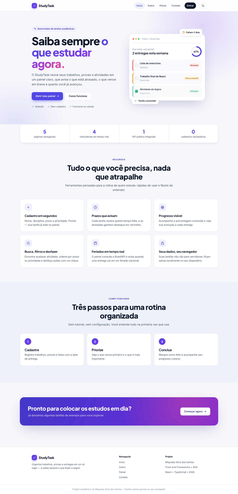
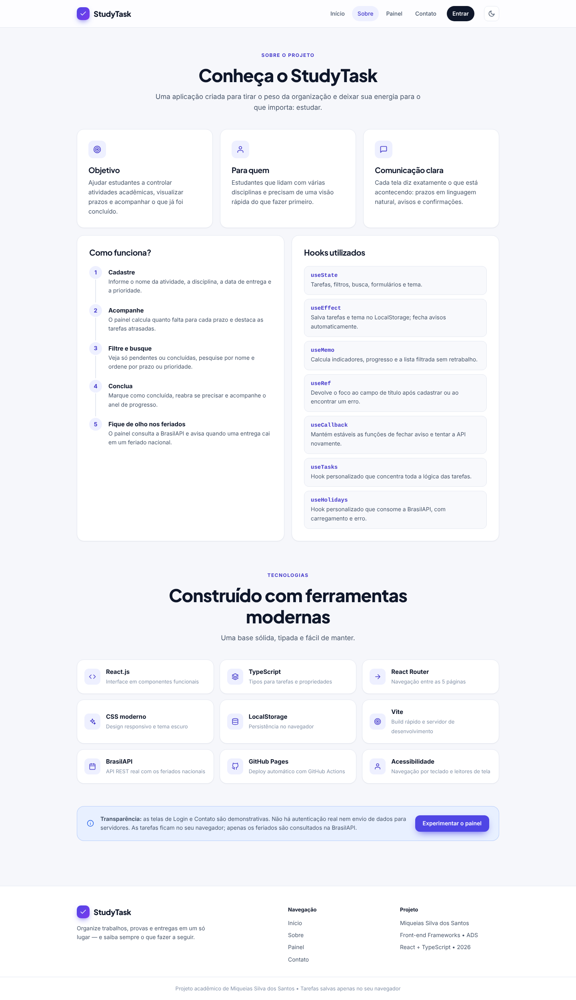
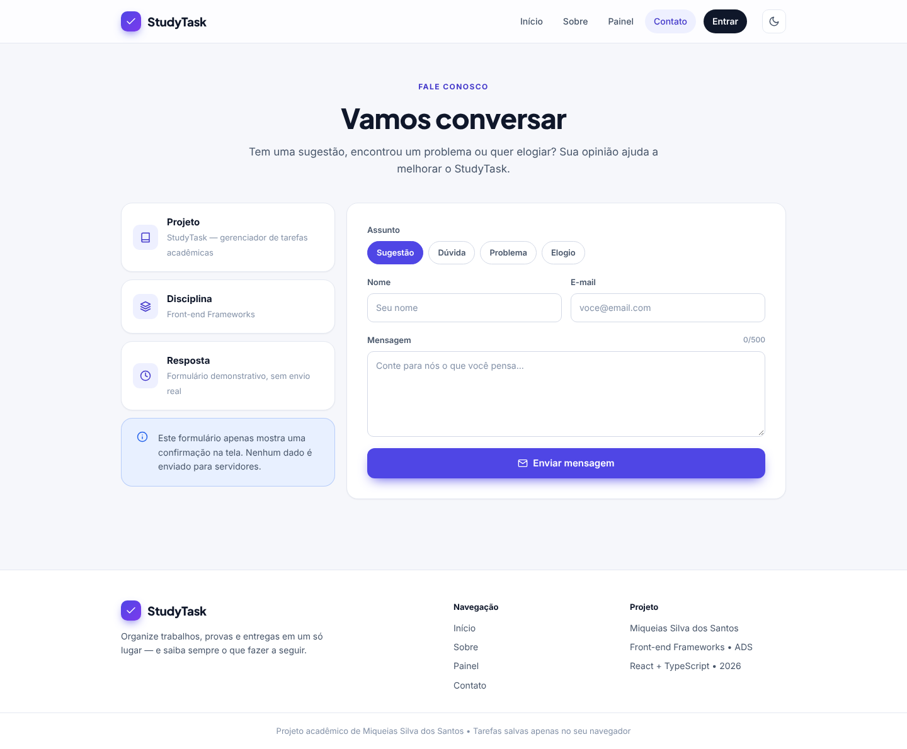
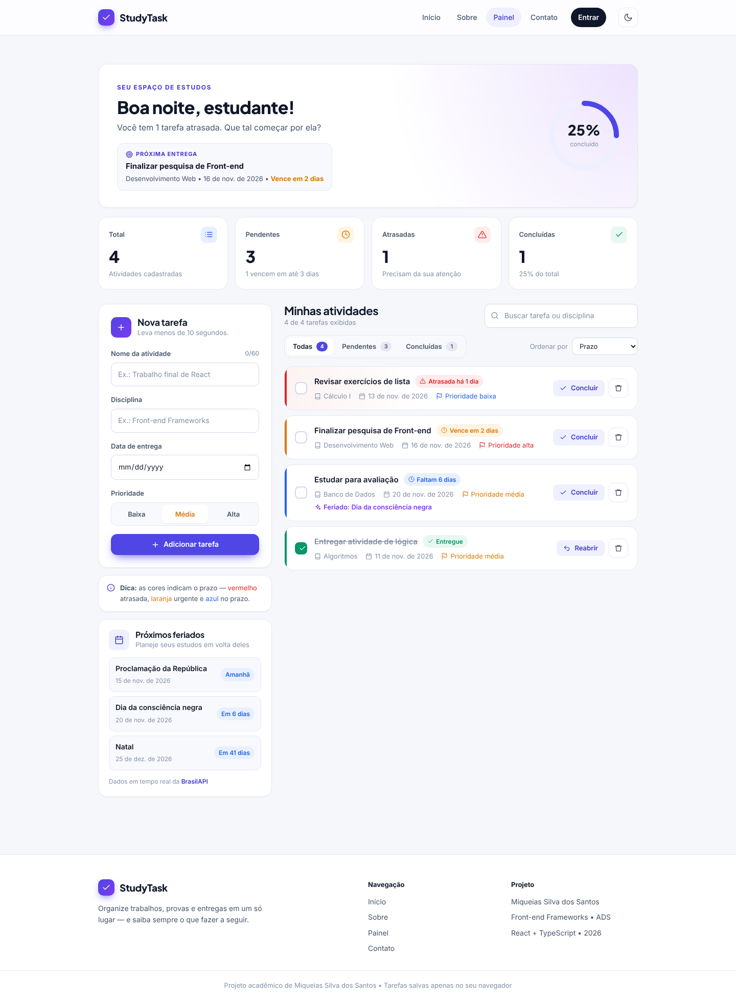
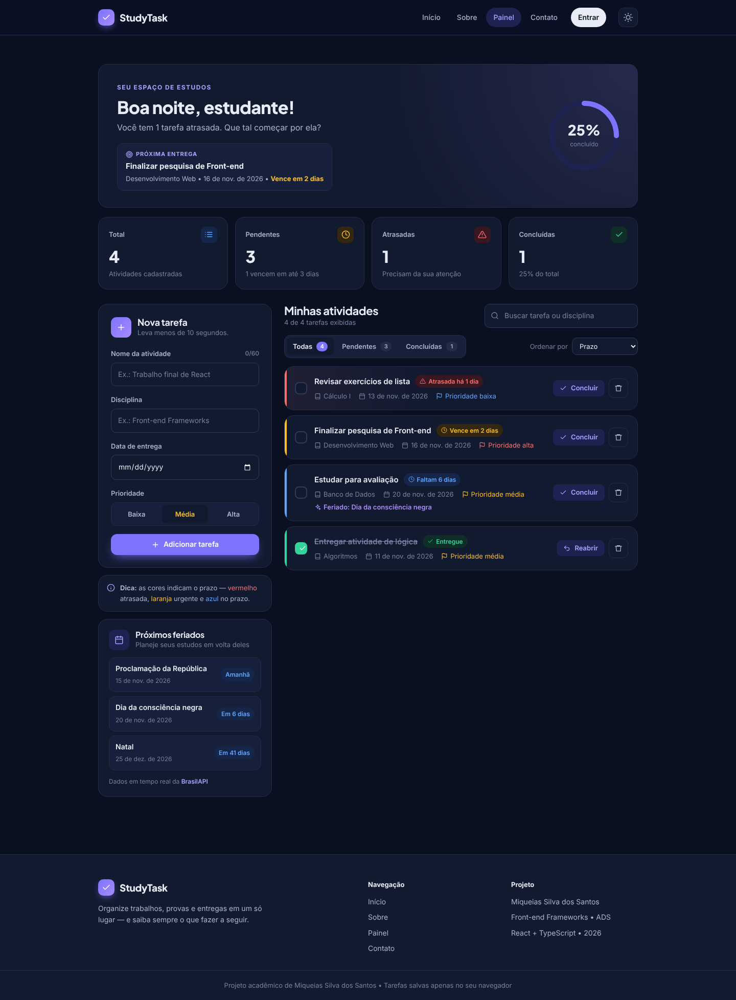

# StudyTask: gerenciador de tarefas acadêmicas


Trabalho final (AV2) da disciplina **Front-end Frameworks**, do curso de **Análise e Desenvolvimento de Sistemas**.

O **StudyTask** ajuda estudantes a cadastrar, acompanhar, concluir e excluir tarefas acadêmicas. O painel mostra em linguagem simples o que está atrasado, o que vence em breve, quanto do trabalho já foi feito e quais feriados nacionais estão chegando. Os feriados vêm da **BrasilAPI**.

🔗 **Deploy:** https://santosmiqueias.github.io/studytask-trabalho-final/
🎥 **Vídeo da apresentação:** _adicionar o link do YouTube_



---

## 👤 Integrante e componentes

| Integrante | Responsável por |
|---|---|
| **Miqueias Silva dos Santos** | Projeto completo: todos os 12 componentes funcionais, as 5 páginas, os hooks, a integração com a API e o deploy |

O grupo tem um único integrante. Por isso, todos os componentes abaixo foram desenvolvidos e são apresentados por ele.

| # | Componente | Arquivo | Responsabilidade |
|---|---|---|---|
| 1 | `Header` | `src/components/Header.tsx` | Menu de navegação, menu mobile e botão de tema claro/escuro |
| 2 | `Footer` | `src/components/Footer.tsx` | Rodapé com links e identificação do projeto |
| 3 | `SectionTitle` | `src/components/SectionTitle.tsx` | Título, subtítulo e descrição padronizados das seções |
| 4 | `StatCard` | `src/components/StatCard.tsx` | Indicadores do painel (total, pendentes, atrasadas, concluídas) |
| 5 | `TaskBadge` | `src/components/TaskBadge.tsx` | Selo com a situação do prazo ("Vence hoje", "Atrasada há 2 dias"…) |
| 6 | `TaskCard` | `src/components/TaskCard.tsx` | Exibe uma tarefa; concluir, reabrir e excluir com confirmação |
| 7 | `TaskForm` | `src/components/TaskForm.tsx` | Formulário de cadastro com validação por campo e prioridade |
| 8 | `EmptyState` | `src/components/EmptyState.tsx` | Mensagem contextual quando não há tarefas para exibir |
| 9 | `ProgressRing` | `src/components/ProgressRing.tsx` | Anel com a porcentagem de tarefas concluídas |
| 10 | `Toast` | `src/components/Toast.tsx` | Aviso após cada ação, com botão "Desfazer" |
| 11 | `HolidayCard` | `src/components/HolidayCard.tsx` | Próximos feriados da BrasilAPI, com carregamento e erro |
| 12 | `Icon` | `src/components/Icon.tsx` | Ícones SVG leves, sem bibliotecas externas |

---

## ✅ Requisitos do trabalho

| Requisito do enunciado | Como foi atendido |
|---|---|
| React.js com **TypeScript** | Todo o código está em `.ts`/`.tsx`, com tipos em `src/types.ts` e props tipadas |
| Mínimo de **8 componentes funcionais** | **12 componentes** (tabela acima) |
| Pelo menos **5 páginas** | **Início, Sobre, Login, Painel e Contato**, além de uma página 404 |
| Ao menos **4 hooks diferentes** | `useState`, `useEffect`, `useMemo`, `useRef`, `useCallback` e os hooks próprios `useTasks` e `useHolidays` |
| Roteamento | React Router DOM (`src/App.tsx`) |
| Integração com dados | Dados estáticos e LocalStorage para as tarefas, e **API REST real** (BrasilAPI) para os feriados |
| **Backend/API (opcional, +1,0)** | Consumo da BrasilAPI em `src/services/holidaysApi.ts` e `src/hooks/useHolidays.ts` |
| README com instalação e uso | Seções abaixo |
| Identificação dos membros e componentes | Seção "Integrante e componentes" |
| Prints das telas | Seção "Telas da aplicação" |
| **Deploy (opcional)** | GitHub Pages com deploy automático por GitHub Actions |

### Hooks utilizados

| Hook | Onde | Para quê |
|---|---|---|
| `useState` | Formulários, painel, cabeçalho | Tarefas, filtros, busca, ordenação, tema, avisos e erros de validação |
| `useEffect` | `useTasks`, `useHolidays`, `Header`, `Toast`, `App` | Salvar no LocalStorage, buscar dados na API, aplicar o tema, fechar avisos e atualizar o título da página |
| `useMemo` | `useTasks`, `useHolidays`, `Dashboard` | Calcular indicadores, progresso, lista filtrada/ordenada e próximos feriados |
| `useRef` | `TaskForm` | Devolver o foco ao campo de título após cadastrar ou quando há erro |
| `useCallback` | `Dashboard`, `useHolidays` | Manter estáveis as funções de fechar aviso e tentar a API novamente |
| `useTasks` *(custom)* | `src/hooks/useTasks.ts` | Concentrar a lógica de adicionar, concluir, excluir e restaurar tarefas |
| `useHolidays` *(custom)* | `src/hooks/useHolidays.ts` | Consumir a BrasilAPI, com estados de carregamento, sucesso e erro |

### Integração com API (BrasilAPI)

- **Endpoint:** `GET https://brasilapi.com.br/api/feriados/v1/{ano}` (API REST pública e gratuita, sem chave)
- O painel busca os feriados do ano atual e do próximo, mostra os 3 próximos e **avisa quando a data de entrega de uma tarefa cai em um feriado nacional**.
- Enquanto carrega, o card mostra um esqueleto animado. Se a API falhar, aparece uma mensagem de erro com o botão **"Tentar novamente"**.
- A requisição é cancelada (`AbortController`) se o usuário sair da página antes da resposta.

---

## 🖼️ Telas da aplicação

| Início | Sobre |
|---|---|
|  |  |

| Login | Contato |
|---|---|
|  |  |

**Painel**: indicadores, progresso, tarefas com prazos comunicados por cor e feriados da API



| Painel no tema escuro | Celular: início | Celular: painel |
|---|---|---|
|  |  |  |

---

## 🚀 Como executar

Pré-requisito: [Node.js](https://nodejs.org/) versão LTS (18 ou superior).

```bash
git clone https://github.com/santosmiqueias/studytask-trabalho-final.git
cd studytask-trabalho-final
npm install
npm run dev
```

Abra no navegador o endereço exibido pelo Vite (normalmente `http://localhost:5173`).

### Versão de produção

```bash
npm run build
npm run preview
```

### Deploy no GitHub Pages

O workflow `.github/workflows/deploy.yml` publica o site automaticamente a cada push na branch `main`.
Para ativar, faça uma única vez: **Settings → Pages → Build and deployment → Source: GitHub Actions**.

---

## 🧭 Como usar

1. Na **página inicial**, clique em **"Abrir meu painel"**. Já existem tarefas de exemplo para explorar.
2. No **Painel**, preencha o nome, a disciplina, a data e a prioridade e clique em **"Adicionar tarefa"**. Campos vazios mostram uma mensagem explicando o que falta.
3. Clique na caixinha ou em **"Concluir"** para finalizar uma tarefa. Use **"Reabrir"** para voltar atrás.
4. Para excluir, clique na lixeira e confirme. Se mudar de ideia, clique em **"Desfazer"** no aviso que aparece embaixo.
5. Use a **busca**, as **abas** (Todas/Pendentes/Concluídas) e a **ordenação** (prazo, prioridade, recentes).
6. Veja os **próximos feriados** no card lateral. Tarefas que vencem em feriado recebem um aviso.
7. Alterne entre **tema claro e escuro** pelo botão no topo.

> As telas de **Login** e **Contato** são demonstrativas: não há autenticação real nem envio de mensagens para servidor. As tarefas ficam salvas no **LocalStorage** do navegador.

---

## 🗂️ Estrutura do projeto

```text
src/
  components/   # 12 componentes funcionais reutilizáveis
  hooks/        # hooks personalizados: useTasks e useHolidays
  pages/        # Home, About, Login, Dashboard, Contact e NotFound
  services/     # acesso à BrasilAPI (holidaysApi.ts)
  utils/        # funções de data e cálculo de prazos
  App.tsx       # rotas e layout
  main.tsx      # inicialização com BrowserRouter
  types.ts      # tipos e interfaces TypeScript
  styles.css    # design system (tokens, tema escuro, responsivo)
docs/screenshots/  # prints das telas
```

## 🛠️ Tecnologias

React.js 18 · TypeScript 5 · Vite 6 · React Router DOM 7 · CSS moderno (variáveis, grid, tema escuro) · LocalStorage · BrasilAPI · GitHub Actions + GitHub Pages
